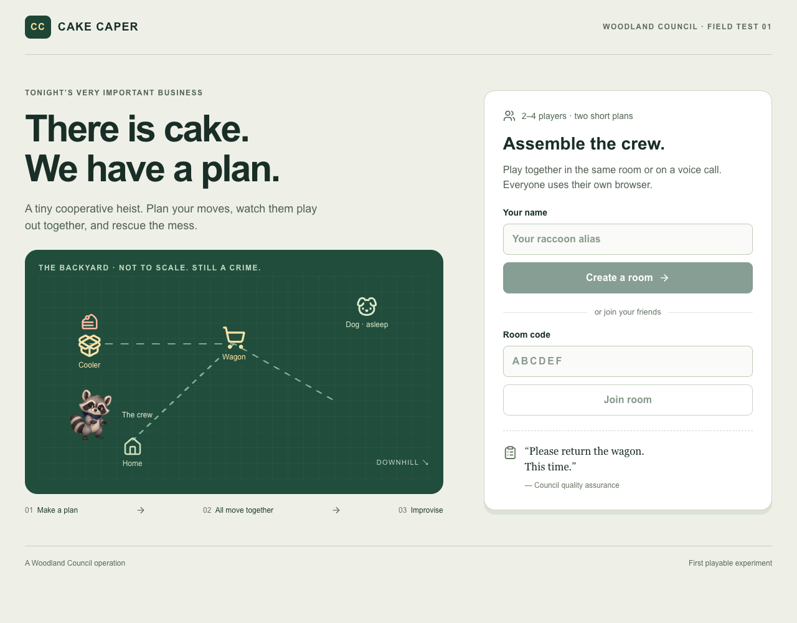

# Cake Caper - A Woodland Council Operation

**There is cake. We have a plan.**

A small cooperative raccoon heist for 2-4 players. Plan together, commit your moves, watch the consequences, and rescue the mess.



**[Open the game](https://woodland-cake-caper.kyrad523765.chatgpt.site)** · **[Illustrated preview (PDF)](docs/cake-caper-preview.pdf)** · **[Game overview](docs/preview.md)**

The game and this repository are private. The hosted game currently allows its owner's account; a repository invitation does not grant game access. The preview PDF and screenshots can be uploaded directly to a chat for a visual tour without opening the game.

Players share a room code, discuss two actions each, commit privately, and watch both beats resolve together. A coordinated first plan can succeed. A mistake changes the board and leaves one recovery plan. The incident report is computed from the actual event log.

## What is playable

- One backyard mission, one cake, one cooler, one wagon, and one dog.
- Room codes, 2-4 human players, and private two-action plans.
- A synchronized reveal, followed by one recovery plan if needed.
- Saved seats on the same browser, a planning deadline, and host recovery when someone disconnects.
- A factual incident report with Woodland Council commentary.
- A responsive browser interface and original raccoon artwork.

This is the first playable experiment. Group playtesting, replayability, and further polish are still ahead.

## Play

1. Open the game in two independent browser tabs or devices.
2. Create a room with a nickname. A second player joins with the six-letter code.
3. The host starts the mission. Every player selects one action for each of two beats and commits.
4. Once all players commit, the server resolves the actions and all players see the same replay. Each plan has a two-minute deadline; players without a locked plan wait for both beats. The host can add one minute or reveal early after 30 seconds.
5. Recover the cake on the second plan if needed. The host can return the crew to the lobby for another try.

Closing a view keeps the seat saved on that browser. A new tab offers explicit **Resume seat** choices; each existing tab keeps its own active seat. In the lobby, **Leave room** frees your seat and the host can remove abandoned seats. After 45 seconds without contact from the host, another player can take over hosting without changing the crew or its locked moves.

The local address is only reachable on this Mac. A private Sites deployment is for the owner; it is not yet the public, login-free competition entry.

## The five actions

- **Open cooler:** hold its spring-loaded lid open for one beat.
- **Carry cake:** load the cake, or retrieve it from the grass.
- **Brace wagon:** control a teammate's push on the same beat.
- **Push wagon:** deliver the loaded cake when braced; otherwise the wagon rolls down the slope and spills its contents.
- **Distract dog:** let a teammate recover a fallen cake while the awake dog is occupied.

A clean two-player plan: player one chooses Open then Brace; player two chooses Carry then Push.

A recoverable mistake: player one chooses Open then Distract; player two chooses Carry then Push. The second plan can pair Distract with Carry, then Brace with Push.

This is a deterministic rules experiment, not a general physics simulation. Spatial transitions illustrate resolved actions. There is one backyard, one cake, one wagon, one dog, 2–4 human players, and at most two planning cycles. The first test is whether the rules, consequences, and rescue make sense. Its long-term replayability and fun still need human playtesting.

## Local development

Requires Node 22.13 or newer. In an already initialized checkout:

```sh
npm run dev -- --host 127.0.0.1
```

The development server prints its local URL. The original development checkout already has local D1 migrations applied; clones need the setup below.

For a fresh checkout (requires repository access):

```sh
git clone https://github.com/TheMostRabidRaccoon/cake-caper.git
cd cake-caper
npm run install:ci
npm run build
node --import ./scripts/sites-env.mjs ./node_modules/wrangler/bin/wrangler.js d1 execute DB --local --config dist/server/wrangler.json --persist-to .wrangler/state --file drizzle/0000_sour_mysterio.sql
npm run dev -- --host 127.0.0.1
```

Run checks:

```sh
node --test tests/*.test.mjs
npx tsc --noEmit
npm run build
```

With the local server running, `node tests/room-api.mjs http://localhost:5173` checks the real API and D1 database, including concurrent commits, an actual host absence and an actual two-minute deadline. It creates isolated test rooms and closes them when finished; it refuses non-local URLs.

The checked-in SQL migration initializes a new local database. Run `npm run db:generate` only after changing the database schema.

## Source and deployment

GitHub stores the source, artwork, documentation, and preview. The original checkout uses a remote named `github` so the Sites publishing workflow can continue independently. After committing source updates, push with `git push github main` from that checkout. A fresh clone uses the standard `origin` remote.

A GitHub push does not publish a new game version. The live game is deployed separately with Sites, using the existing project in `.openai/hosting.json`. Preserve that project when publishing updates.

Local environment files, player databases, dependencies, build output, and generated TypeScript caches are excluded from new commits. The hosting manifest contains the project identifier and binding names, not credentials.

## How it works

- `lib/game.ts`: action rules, room lifecycle, presence, deadlines, event log, replay timing, and report.
- `lib/versioned-room.ts`: retryable room updates; concurrent requests recheck the latest version before writing.
- `lib/seat-storage.ts`: device-local saved-seat choices and recoverable session errors.
- `app/api/room/route.ts`: authenticated per-player room actions, validation, and public views.
- `db/rooms.ts`: authoritative D1 state with optimistic version checks to avoid lost simultaneous commits.
- `app/game.tsx`: lobby, two-beat planner, synchronized reveal, and incident report.
- `app/board.tsx`: the game board and animated pieces.

The active seat is kept in sessionStorage for each tab; resume credentials are saved in localStorage on the same browser. Clearing browser data loses those credentials, and they do not transfer to another browser or device. Credentials are never included in URLs or reports. Public room views omit all tokens and other players' plans until the reveal; even then tokens remain private.

The server owns deadlines and accepted plans. Requests advance an elapsed deadline or replay atomically, so a backgrounded tab cannot pause planning. Presence writes are throttled to one every 15 seconds per player. Lobby departures/removals revoke the departed seat; a host departure transfers hosting. Rooms expire 24 hours after creation, or immediately when their last player leaves. Expired data is inaccessible, but automatic database deletion is not implemented.

Rooms created before the recovery update show a clear request to create a new room. Their stored plans are not silently converted. Existing screenshots and the PDF show the September 28 prototype; see the [room-recovery notes](docs/room-recovery.md) for the current change and its checks.

## Cost and artwork

Playing and generating reports use fixed game rules; no model API is called. Hosting and storage are separate platform resources. One original raccoon asset was generated with the built-in image-generation tool and is stored at `public/raccoon.png`. Its exact prompt is in `docs/raccoon-art-prompt.txt`.

The [screenshots](docs/screenshots/README.md) come from local browser tests on September 28 and October 6, 2026. The [original verification notes](docs/verification.md) and [room-recovery notes](docs/room-recovery.md) describe the checks and their limits.

## Competition boundary

This is a private prototype and design experiment, not a submitted contest entry. Public access, broader testing, final polish, and the Handshake submission package remain separate later steps. The mission's ChatGPT Work walkthrough and final requirements should be checked before entry.
