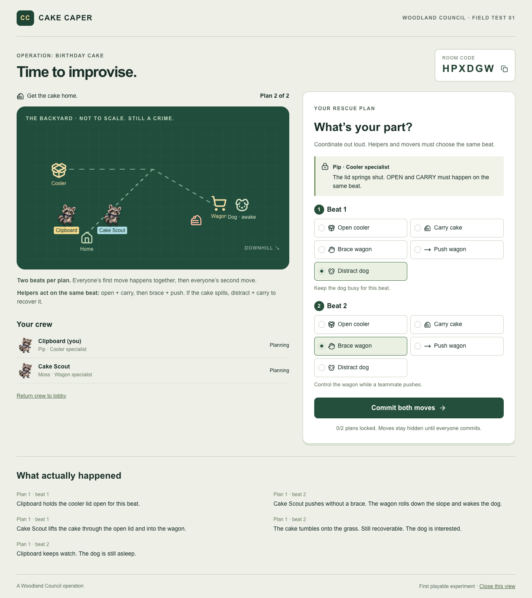
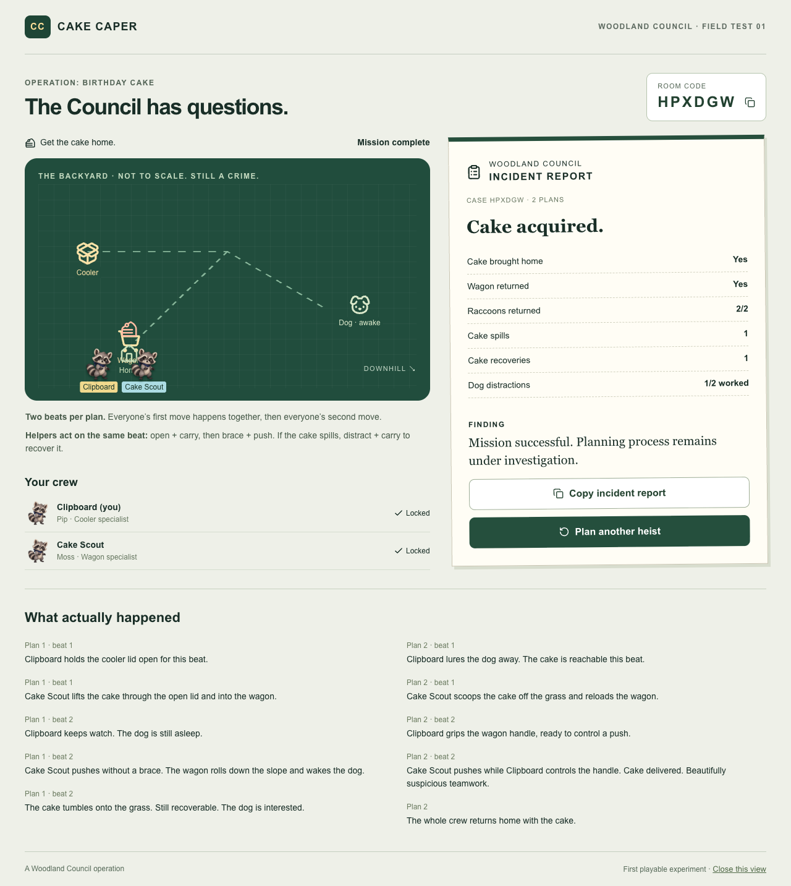

# Cake Caper: a first look

**There is cake. We have a plan.**

Cake Caper is a cooperative raccoon heist made by Kyra and Codex. The working subtitle is **A Woodland Council Operation**. The first playable version is deliberately small: one backyard, one cooler, one cake, one wagon, one dog, and 2-4 raccoons.

[Private game](https://woodland-cake-caper.kyrad523765.chatgpt.site) · [Private source repository](https://github.com/TheMostRabidRaccoon/cake-caper) · [Illustrated PDF](cake-caper-preview.pdf)

## The invitation

Players create or join a room with a code and coordinate in person or on a voice call. Each player uses a separate browser session.

## The plan, and what happens to it

Each player chooses two actions. Everyone's first action resolves together, followed by everyone's second action. The five actions are Open Cooler, Carry Cake, Brace Wagon, Push Wagon, and Distract Dog.

Opening the spring-loaded lid and carrying the cake need to happen on the same beat. So do bracing and pushing the wagon. An unbraced push sends the wagon downhill, spills the cake, and wakes the dog. That changes the board and leaves one rescue plan: distract the dog while someone retrieves the cake, then coordinate the getaway.

The rules are deterministic. A good first plan is allowed to work; the game does not invent a disaster to force a rescue. The animation illustrates the outcome of the rules. This prototype is not a general physics simulation.

## The Council has questions

The report comes from the actual event log. In this recorded test the crew brought home the cake and wagon, returned 2/2 raccoons, spilled the cake once, and recovered it once. One of two dog distractions worked.

> Mission successful. Planning process remains under investigation.

The humor is optional flavor around understandable actions and consequences. Players do not need to know the Woodland Council lore.

## What exists, and what comes next

The prototype has room creation and joining, private plans, simultaneous resolution, reload recovery, a responsive interface, original raccoon artwork, and event-based reports. The two-browser scenario, six rule tests, TypeScript check, and production build were verified during the September 28 development session; see [the verification record](verification.md).

The next design questions are whether new players understand the timing, laugh at the consequences, enjoy the rescue, and want another round. The current version has one fixed mission; broader replayability and group playtesting remain ahead.

Playing and generating reports make no model API calls. Hosting and storage are separate resources. The game is a private prototype, not a submitted contest entry.

## Showing the prototype in another chat

Upload `cake-caper-preview.pdf` for an illustrated tour. The PNGs in `screenshots/` can also be attached individually, and this Markdown file provides the text overview. A private URL alone may be inaccessible from another chat. This package shows the game; it does not let the recipient play it.

Prepared September 30, 2026. Screenshots were captured during local testing on September 28, before small final board-label spacing adjustments. They are actual interface captures, not concept mockups.
